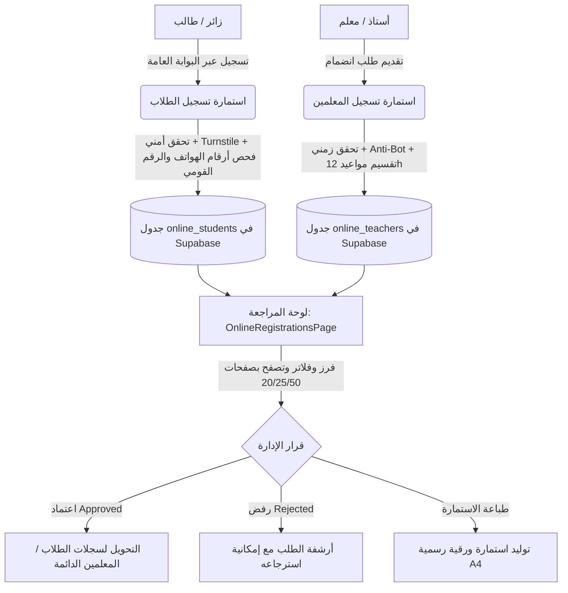

# 📚 الدليل الشامل والمفصل لاستمارات التسجيل ونماذج البيانات
### نظام أطلس لإدارة المراكز والأكاديميات التعليمية (Atlas ERP System)

---

> **📌 تنويه للمستخدم:**  
> تم إنشاء هذا الملف بناءً على طلبك ليكون مرجعاً توضيحياً وشاملاً لجميع حقول، آليات عمل، وحماية النماذج والاستمارات الإلكترونية في النظام. يمكنك الاحتفاظ به كمرجع، أو حذفه في أي وقت بمجرد الانتهاء من مراجعته.

---

## 📑 فهرس المحتويات

1. [نظرة عامة ومخطط دورة حياة البيانات (Lifecycle Workflow)](#1-نظرة-عامة-ومخطط-دورة-حياة-البيانات)
2. [استمارة تسجيل الطلاب الإلكترونية (Student Registration Portal)](#2-استمارة-تسجيل-الطلاب-الإلكترونية)
   - [خطوات الاستمارة وحقول البيانات](#حقول-استمارة-تسجيل-الطلاب)
   - [الآليات الذكية وفحص البيانات (Validation)](#الآليات-الذكية-في-استمارة-الطلاب)
   - [معالجة الإرسال وحفظ المسودة](#معالجة-الإرسال-وحفظ-المسودة)
3. [استمارة انضمام المعلمين الإلكترونية (Teacher Registration Portal)](#3-استمارة-انضمام-المعلمين-الإلكترونية)
   - [مراحل الاستمارة الخمس (5-Step Wizard)](#مراحل-استمارة-المعلمين)
   - [جدول الحقول البرمجية الشامل](#جدول-حقول-استمارة-المعلمين)
   - [نظام المجموعات واختيار مادة لكل مجموعة ونظام 12 ساعة](#نظام-المجموعات-والمواعيد-المقترحة)
   - [نظام المساعدين وتخزين البيانات المرن (Fallback Architecture)](#نظام-المساعدين-والتخزين-المرن)
4. [لوحة تحكم إدارة ومراجعة الاستمارات (Admin Registrations Dashboard)](#4-لوحة-تحكم-إدارة-ومراجعة-الاستمارات)
   - [الفلاتر والبحث وتقسيم الصفحات (Pagination)](#الفلاتر-والتقسيم-لصفحات)
   - [شاشة مراجعة الطالب (Student Modal)](#شاشة-مراجعة-الطالب)
   - [شاشة مراجعة المعلم وجدول المجموعات (Teacher Modal)](#شاشة-مراجعة-المعلم)
   - [عارض الصور والمستندات (Lightbox Preview)](#عارض-الصور-والمستندات)
   - [محرك الطباعة المباشرة للاستمارة الرسمية](#محرك-الطباعة-الرسمية)
5. [الاستمارات والنماذج الداخلية بالنظام (Internal ERP Forms)](#5-الاستمارات-والنماذج-الداخلية-بالنظام)
6. [مصفوفة الأمان والحماية البرمجية](#6-مصفوفة-الأمان-والحماية-البرمجية)

---

## 1. نظرة عامة ومخطط دورة حياة البيانات

يقوم النظام على نموذج **فصل البوابة العامة (Public Portal)** عن **لوحة الإدارة الداخلية (ERP Admin Panel)**، لضمان عدم إدخال أي طالب أو معلم مباشرة إلى قاعدة البيانات التشغيلية إلا بعد المراجعة البشرية والاعتماد من الإدارة.



---

## 2. استمارة تسجيل الطلاب الإلكترونية
* **الملف البرمجي:** `client/src/pages/portal/StudentRegistrationPage.jsx`
* **المسار في المتصفح:** `/portal/register/student`
* **الجدول بقاعدة البيانات:** `online_students` (Supabase)

### حقول استمارة تسجيل الطلاب

| اسم الحقل في الواجهة | المفتاح البرمجي (`formData`) | الحقل في قاعدة البيانات | نوع البيانات | الإلزامية | قواعد التحقق والشروط (Validation Rules) |
| :--- | :--- | :--- | :--- | :--- | :--- |
| **اسم الطالب رباعي** | `full_name` | `full_name` | `text` | 🔴 إلزامي | اسم ثنائي على الأقل (يفضل رباعي)، بالعربية، خالي من الرموز. |
| **الرقم القومي للطالب** | `national_id` | `national_id` | `text` (14 chars) | 🔴 إلزامي | 14 رقماً مصرياً يبدأ بـ 2 أو 3. يتم منه استخراج تاريخ الميلاد والسن والنوع تلقائياً. |
| **رقم هاتف الطالب** | `phone` | `phone` | `text` (11 digits) | 🟡 مشروط | 11 رقماً مصرياً يبدأ بـ (010, 011, 012, 015)، مع فحص ذكي للأرقام الوهمية. (يمكن تخطيه لطلاب الابتدائي). |
| **هاتف ولي الأمر (الأب)** | `father_phone` | `father_phone` | `text` (11 digits) | 🔴 إلزامي | 11 رقماً مصرياً صحيحاً، يتم استخدامه كقناة تواصل رئيسية وإرسال تقارير الغياب والدرجات. |
| **هاتف ولي الأمر (الأم)** | `mother_phone` | `mother_phone` | `text` (11 digits) | ⚪ اختياري | رقم هاتف بديل للتواصل في حالات الطوارئ. |
| **وظيفة ولي الأمر** | `parent_job` | `parent_job` | `text` | ⚪ اختياري | نص حتى 80 حرف. |
| **المرحلة والصف الدراسي** | `academic_grade` | `academic_grade` | `text` | 🔴 إلزامي | قائمة منسدلة (من الصف الأول الابتدائي حتى الصف الثالث الثانوي). |
| **نوع التعليم** | `education_type` | `education_type` | `text` | 🔴 إلزامي | خيارات: (عام، لغات، أزهري، تجريبي، دولي). |
| **اسم المدرسة** | `school_name` | `school_name` | `text` | 🔴 إلزامي | اسم مدرسة الطالب المقيد بها حالياً. |
| **النوع / الجنس** | `gender` | `gender` | `text` (male/female) | 🔴 إلزامي | يتم تحديده تلقائياً من الرقم القومي (الرقم الـ 13: فردي=ذكر، زوجي=أنثى). |
| **تاريخ الميلاد** | `birth_date` | `birth_date` | `date` | 🔴 تلقائي | يتم استخراجه وحسابه تلقائياً من الرقم القومي بصيغة `YYYY-MM-DD`. |
| **العنوان بالتفصيل** | `address` | `address` | `text` | 🔴 إلزامي | نص تفصيلي (المحافظة - المركز / المنطقة - الشارع). |
| **الصورة الشخصية** | `photo_url` | `photo_url` | `text` (URL) | ⚪ اختياري | رفع صورة الطالب الشخصية لاستخراج كارت الحضور ورمز QR لاحقاً. |
| **ملاحظات إضافية** | `notes` | `notes` | `text` | ⚪ اختياري | أي تفاصيل صحية أو تعليمية خاصة يود الطالب أو ولي الأمر توضيحها. |

---

### الآليات الذكية في استمارة الطلاب

1. **التحليل الذكي للرقم القومي المصري (`parseEgyptianNationalId`):**
   * بمجرد إدخال الرقم القومي المكون من 14 رقماً، يقوم النظام فوراً بفك شفرته:
     * تحديد قرن الميلاد (2 للقرن العشرين 1900-1999، و 3 للقرن الحادي والعشرين 2000 فما فوق).
     * استخراج سنة وشهر ويوم الميلاد بالصيغة العربية الدقيقة (`يوم / شهر / سنة`).
     * حساب عمر الطالب الحالي بدقة.
     * استنتاج نوع الطالب (`ذكر` أم `أنثى`) دون الحاجة لاختياره يدوياً.
2. **الفحص الصارم لأرقام الهواتف المحمولة (`isValidRealEgyptianPhone`):**
   * التحقق من بادئات شبكات المحمول المصرية المعتمدة (`010`, `011`, `012`, `015`).
   * **كشف الأرقام الوهمية:** منع الأرقام التي تحتوي على أقل من 4 أرقام فريدة (مثل: `01000000000` أو `01212121212`).
   * منع تكرار الرقم الواحد لأكثر من 4 مرات متتالية (مثل: `01055555123`).
   * منع السلاسل الرقمية المتتالية صعوداً أو هبوطاً (مثل: `01234567890` أو `01098765432`).
3. **ميزة طلاب الابتدائي (بدون هاتف):**
   * عند تفعيل خيار "طالب صغير بالسن ولا يملك هاتفاً خاصاً"، يتم تعطيل شرط هاتف الطالب، ويتم تسجيل ولي الأمر كوسيلة التواصل المباشرة مع وضع وسم توضيحي في الملاحظات تلقائياً.

---

### معالجة الإرسال وحفظ المسودة
* **حفظ المسودة التلقائي (Draft Auto-Save):** أي تعديل يقوم به الطالب يُحفظ فوراً في `localStorage` بالمتصفح برمز `atlas_student_registration_draft`، فإذا انقطع الاتصال أو أُغلقت الصفحة بالخطأ، تعود بياناته كاملة دون فقدانها.
* **المرونة الفائقة (Schema Fallback):** إذا كان حقل مثل `photo_url` غير مهيأ بعد في قاعدة البيانات، يقوم الكود برصد الخطأ تلقائياً وإعادة إرسال الطلب بعد نقل رابط الصورة إلى حقل `notes` المنسق لتفادي أي فشل في الإرسال من طرف الطالب نهائياً.

---

## 3. استمارة انضمام المعلمين الإلكترونية
* **الملف البرمجي:** `client/src/pages/portal/TeacherRegistrationPage.jsx`
* **المسار في المتصفح:** `/portal/register/teacher`
* **الجدول بقاعدة البيانات:** `online_teachers` (Supabase)

---

### مراحل استمارة المعلمين (5 خطوات تفاعلية)

```
[خطوة 1: البيانات الشخصية والتعريفية] ➡️ [خطوة 2: التخصصات والمراحل] ➡️ [خطوة 3: المجموعات والمواعيد المقترحة] ➡️ [خطوة 4: فريق المساعدين والسوشيال] ➡️ [خطوة 5: الوثائق والشروط والإرسال]
```

---

### جدول حقول استمارة المعلمين

| الخطوة | الحقل في الواجهة | المفتاح البرمجي | نوع الحقل | الوصف وقواعد التحقق |
| :--- | :--- | :--- | :--- | :--- |
| **1** | **الاسم الثلاثي / الرباعي** | `full_name` | نص | اسم الأستاذ الرسمي للتعاقد والسجلات. |
| **1** | **اسم الشهرة / اللقب التجاري** | `nickname` | نص | الاسم المعروف به لدى الطلاب (مثل: القيصر، دكتور الكيمياء، إلخ). |
| **1** | **رقم هاتف المعلم الشخصي** | `phone` | 11 رقم | فحص رقم هاتف حقيقي مصري. |
| **1** | **رقم واتساب المعلم / العمل** | `whatsapp_phone` | 11 رقم | رقم مخصص للمراسلات الرسمية وجروبات الواتساب. |
| **1** | **الرقم القومي للمعلم** | `national_id` | 14 رقم | تحقق مصري وفحص عدم تكرار التقديم مسبقاً بنفس الرقم. |
| **1** | **الصورة الشخصية والشعار** | `photo_url`, `logo_url` | رفع روابط | صورة المعلم الدعائية وشعار مادته أو سنتره الخاص. |
| **2** | **المواد والتخصصات** | `specializations` | مصفوفة | إمكانية اختيار مادة أو أكثر (عربي، لغة ثانية، كيمياء، ...) مع حقل لإضافة مادة مخصصة. |
| **2** | **الصفوف والمراحل المستهدفة** | `target_grades` | مصفوفة | أزرار سريعة لتحديد مراحل كاملة (الإعدادية، الثانوية العامة، لغات). |
| **3** | **المجموعات الدراسية المقترحة** | `groups` (JSON) | مصفوفة كائنات | تشمل: اليوم، وقت البدء، وقت النهاية، الصف، **المادة المخصصة للمجموعة**. |
| **4** | **فريق المساعدين والسكرتارية** | `assistants` (JSON) | مصفوفة كائنات | اسم كل سكرتير/مساعد ورقم هاتفه (أو اختيار: إدارة شخصية بدون سكرتارية). |
| **4** | **روابط المنصات والسوشيال** | `facebook_link`, `youtube_link`, `telegram_link` | روابط | التحقق الصارم من روابط القنوات والصفحات وتنسيقها التلقائي بـ `https://`. |
| **5** | **النبذة التعريفية وسنوات الخبرة** | `bio` | نص طويل | سيرة ذاتية موجزة وإنجازات المعلم ومدارس العمل السابقة. |
| **5** | **ملاحظات واحتياجات القاعات** | `notes` | نص | متطلبات خاصة (شاشة ذكية، ميكروفون وايرلس، سعة القاعة المطلوبة). |

---

### نظام المجموعات والمواعيد المقترحة

* **تخصيص المادة لكل مجموعة (Per-Group Subject Selection):**
  * إذا كان المعلم يدرس أكثر من مادة (مثلاً: *فيزياء* و *كيمياء*، أو *رياضيات بحتة* و *رياضيات تطبيقية*)، يظهر له قائمة منسدلة داخل كل مجموعة ليختار المادة الخاصة بتلك المجموعة على حدة.
  * في حال قام بحذف تخصص، يتولى النظام تلقائياً إعادة ضبط مجموعاته لتتبع التخصصات المتبقية دون حدوث أي خطأ برمجي.
* **نظام التوقيت بتنسيق 12 ساعة (12-Hour AM/PM Format):**
  * تم استبدال حقول الوقت الكلاسيكية الصعبة (`<input type="time">`) بقوائم مسبقة الحساب بفواصل زمنية 15 دقيقة من الساعة 7:00 صباحاً وحتى 11:45 مساءً.
  * تظهر الخيارات بوضوح فائق للمستخدم باللغة العربية، مثل:
    * `02:00 مساءً (م)`
    * `10:30 صباحاً (ص)`
    * `12:00 ظهراً (م)`
* **حساب مدة الحصة ومراجعتها آلياً:**
  * يمنع النظام اختيار وقت نهاية يسبق أو يساوي وقت البداية.
  * يرفض الحصص التي تقل عن 30 دقيقة أو تتجاوز 6 ساعات.
  * يعرض للمدرس نصاً عربياً فورياً بمدة الحصة (مثلاً: `ساعتان`، أو `ساعة و 30 دقيقة`).

---

### نظام المساعدين والتخزين المرن

* **فريق السكرتارية والمساعدين:**
  * إمكانية إضافة عدد غير محدود من المساعدين مع أسمائهم وأرقام هواتفهم.
  * في حال كان المعلم يفضل إدارة حجوزاته بنفسه، يتوفر خيار بنقرة واحدة: **"أقوم بإدارة مواعيدي ومجموعاتي بنفسي (بدون سكرتارية)"**.
* **البنية التخزينية المرنة (Zero-Downtime Fallback):**
  * يتم تخزين المجموعات والمساعدين كحقول كائنات `JSON` في `groups_data` و `assistants_data`.
  * إذا كانت قاعدة البيانات في وضع Migration أو لم يتم تحديث كاش الأعمدة، يقوم التطبيق بذكاء بتضمين البيانات داخل حقل `notes` المنسق كالتالي:  
    `[المجموعات المقترحة]: [...]`  
    `[بيانات المساعدين]: [...]`
  * وتقوم شاشة الإدارة بقراءة كلا التنسيقين بسلاسة تامة.

---

## 4. لوحة تحكم إدارة ومراجعة الاستمارات
* **الملف البرمجي:** `client/src/pages/OnlineRegistrationsPage.jsx`
* **المسار في المتصفح:** `/online-registrations`

---

### الفلاتر والتقسيم لصفحات (Pagination)

* **تقسيم الصفحات (Pagination) المتطور:**
  * يدعم تقسيم القوائم إلى شرائح مرنة: **`10` / `20` / `25` / `50` / `100`** عنصر لكل صفحة.
  * عداد ذكي يوضح للمشرف: *(عرض من X إلى Y من إجمالي Z طلب)*.
  * أزرار انتقال سهلة للأجهزة الذكية وشاشات الكمبيوتر مع إعادة الضبط التلقائي للصفحة الأولى عند تغيير أي فلتر.
* **فلاتر متعددة الأبعاد:**
  * **البحث السريع:** يبحث فورياً بالاسم، رقم الهاتف، الرقم القومي، المحافظة، أو التخصص.
  * **فلتر الحالة:** (الكل / قيد المراجعة `pending` / تم القبول `approved` / مرفوض `rejected`).
  * **فلتر المرحلة:** لتصفية طلاب أو معلمي مرحلة معينة.
  * **فلتر المادة واليوم (للمعلمين):** تصفية طلبات المعلمين بناءً على أيام تواجدهم المقترحة بالسنتر أو تخصصهم.

---

### شاشة مراجعة الطالب (Student Modal)

نافذة منبثقة تفاعلية غنية بالتفاصيل تعرض:
1. صورة الطالب الشخصية وشارة حالته الحالية.
2. بطاقة البيانات الشخصية (الرقم القومي مع زر نسخ بنقرة واحدة، تاريخ الميلاد، النوع).
3. بطاقة بيانات الاتصال وولي الأمر (زر مباشر للاتصال التلفوني، وزر مراسلة واتساب لولي الأمر).
4. البيانات الأكاديمية (الصف، نوع التعليم، المدرسة).
5. أزرار التحكم بالحالة:
   * **قبول واعتماد الطالب:** يغير الحالة لـ `approved` مع إشعار نجاح.
   * **رفض الطلب:** يغير الحالة لـ `rejected`.
   * **إعادة لقيد المراجعة:** لتصحيح القرارات الخاطئة.

---

### شاشة مراجعة المعلم (Teacher Modal)

تعرض ملفاً شاملاً لبيانات المعلم المتقدم:
1. **الترويسة:** الصورة والشعار والاسم واللقب والتخصصات وأزرار الاتصال السريع.
2. **جدول المجموعات المقترحة:**
   * جدول منسق يعرض: **اليوم** | **المادة المحددة للمجموعة** | **الصف الدراسي** | **موعد البداية والنهاية بتنسيق 12 ساعة الواضح (ص/م)**.
3. **قائمة المساعدين والسكرتارية:** أسماء وأرقام هواتف الفريق المعاون للمدرس للتنسيق معهم.
4. **السيرة الذاتية وروابط السوشيال:** روابط خارجية مباشرة لصفحات فيسبوك، قنوات يوتيوب، وجروبات التليجرام الخاصة به.
5. **إجراءات الاعتماد أو الرفض** وإمكانية الطباعة.

---

### عارض الصور والمستندات (Lightbox Preview)

* تم تزويد لوحة الإدارة بنافذة معاينة مكبرة (Lightbox) تتيح فحص أي صورة شخصية، هوية وطنية، أو شعار بدقة فائقة دون مغادرة الصفحة، مع زر اختياري لفتح الصورة بالحجم الكامل في تبويب جديد.

---

### محرك الطباعة الرسمية (Print Engine)

* عند النقر على **"طباعة الاستمارة الرسمية"** داخل ملف المعلم:
  * يفتح النظام نافذة طباعة مخصصة ومنسقة بمقاس A4 رسمي.
  * تحتوي على شعار الأكاديمية، كافة بيانات المعلم وتفاصيل مجموعاته ومواعيده بتنسيق جداول مهيأة للطباعة المباشرة (`window.print()`) لتوقيع التعاقد الورقي وحفظه بالأرشيف.

---

## 5. الاستمارات والنماذج الداخلية بالنظام

بجانب استمارات التسجيل الإلكتروني الخارجي، يحتوي نظام **Atlas ERP** على نماذج إدارية داخلية مخصصة للموظفين والمشرفين:

| النموذج الداخلي | الملف المسؤول | وظيفته واستخدامه |
| :--- | :--- | :--- |
| **نموذج إدارة الطلاب الداخلي** | `StudentsPage.jsx` | تسجيل طالب يدوياً من الاستقبال، وتوليد كود الطالب (Barcode / QR)، وتعيينه في المجموعات. |
| **نموذج تفاصيل وملف الطالب** | `StudentDetailPage.jsx` | إدارة اشتراكات الطالب، سجل غيابه وحضوره عبر البوابة، ودرجات امتحاناته. |
| **نموذج إدارة المعلمين الداخلي** | `TeachersPage.jsx` | إدراج معلم معتمد في النظام وتحديد نسبة أتعابه (السنتر / المدرس) ونسب الملازم. |
| **نموذج المجموعات والقاعات** | `GroupsPage.jsx` | إنشاء المجموعات الرسمية، ربطها بالقاعات وتحديد الحد الأقصى لسعة القاعة. |
| **نماذج المالية والاشتراكات** | `FinancePage.jsx` / `StudentSubscriptionsPage.jsx` | إصدار فواتير وسندات القبض للمصروفات الشهرية أو الحصص وحساب اشتراكات الطلاب. |
| **نموذج نقطة البيع والملازم** | `PosPage.jsx` / `BookletsPage.jsx` | بيع الملازم والكتب الدراسية للطلاب وإدارة مخزن الكتب. |

---

## 6. مصفوفة الأمان والحماية البرمجية

تم تطبيق أعلى معايير الحماية في استمارات التسجيل:

```
🛡️ منظومة حماية الاستمارات في Atlas ERP:
┌────────────────────────────────────────────────────────┐
│ 1. Cloudflare Turnstile  : منع البوتات والـ Automated Spam│
│ 2. Honeypot Trap Field   : حقل خفي لإسقاط هجمات الروبوتات │
│ 3. Time-Elapsed Check    : كشف الإرسال السريع غير البشري │
│ 4. Phone Intelligence    : كشف الهواتف الوهمية والتكرار   │
│ 5. National ID Check     : فحص التكوين الرقمي والازدواجية │
│ 6. XSS Sanitization      : تطهير المدخلات من السكريبتات  │
│ 7. Client Draft Recovery : حفظ المسودة بالمتصفح ضد الانقطاع│
└────────────────────────────────────────────────────────┘
```

---

## 🗑️ إرشادات حذف هذا الملف

هذا الملف وُجد لخدمتك ولتسهيل مراجعة وتوثيق جميع نماذج واستمارات المشروع.  
* يمكنك حذفه في أي وقت عبر تشغيل الأمر التالي في التيرمينال:
```bash
rm /home/abdalla/projects/atlas/ERP_Sys/FORMS_DOCUMENTATION.md
```
* أو يمكنك الطلب في أي رسالة قادمة: *"احذف ملف الدليل FORMS_DOCUMENTATION.md"* وسأقوم بحذفه فوراً.
